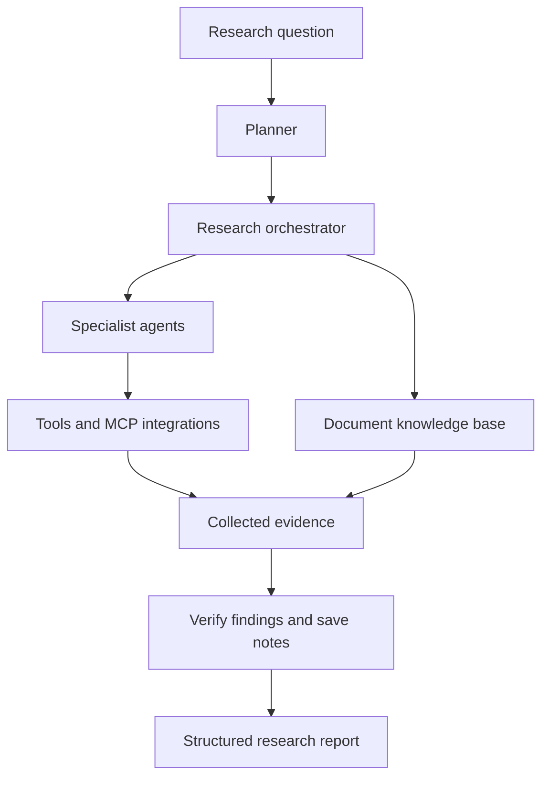

# Autonomous Deep Research Multi-Agent System

A Python research platform that turns a question into a structured, source-backed report. It brings together LLM assistants, conversation memory, reusable tools, document retrieval, agent planning, MCP, and multi-agent orchestration.

The project follows the practical path in [AI Agent Engineering: Build Production-Ready AI Agents](https://www.udemy.com/course/ai-agent-engineering/) by Pankaj Shukla and applies the course’s core techniques to a research workflow.

## What the platform does

The system takes a research question through a repeatable workflow:

- Breaks the question into focused research tasks.
- Uses specialized agents and tools to gather relevant information.
- Retrieves supporting passages from an ingested document collection.
- Keeps research state and notes available across steps.
- Checks findings against their sources and turns them into a structured report.

The same workflow supports both open-ended research and questions grounded in a supplied document set.

## Research workflow

The planner coordinates the work, while tools and document retrieval provide evidence for the final report.

## Skills covered

The course builds these skills progressively. Related ideas are grouped together here so each appears once.

| Area | Skills |
| --- | --- |
| Python and LLM foundations | Python fundamentals, virtual environments, API configuration, local model setup with Ollama, and requests to OpenAI-compatible model endpoints |
| Assistant behavior | System prompts, role-based assistants, prompt design, multi-turn conversation history, and conversational memory |
| Tool engineering | Custom Python tools, request routing, tool selection, a centralized tool manager, file operations, and safe utility functions |
| Documents and RAG | Text and document loading, multi-document knowledge bases, chunking, embeddings, keyword retrieval, semantic search, cosine similarity, grounded question answering, and advanced RAG |
| Agent architecture | Task planning, reasoning, agent state, execution loops, tool use, and autonomous runs |
| MCP integration | MCP architecture, clients and servers, connecting agents to tools, and access to external tools and data |
| Multi-agent systems | Specialized agent roles, delegation, orchestration, and production-ready agent design |
| Agent frameworks | LangChain, LangGraph, and CrewAI |
| Research delivery | Research task execution, source verification, research notes, structured report generation, and application deployment |

## Technology stack

| Layer | Tools and technologies |
| --- | --- |
| Language and environment | Python 3.13, VS Code, virtual environments, and `python-dotenv` |
| Model access | OpenAI Python SDK with an OpenAI-compatible endpoint; Ollama for local models |
| Local Apple Silicon serving | MLX-LM; the included server script starts `Qwen/Qwen3-1.7B-MLX-4bit` on port 8080 |
| Document processing | `pypdf` for PDFs and optional `python-docx` support for Word files |
| Embeddings | Ollama’s OpenAI-compatible embeddings endpoint and the configured `embeddinggemma-2:740m` model |
| Agent interoperability and frameworks | Model Context Protocol (MCP), LangChain, LangGraph, and CrewAI |

The course introduces the agent frameworks and MCP as ways to structure and connect agent workflows. The repository also includes small Python modules that show the underlying assistant, memory, tool, and document concepts directly.

