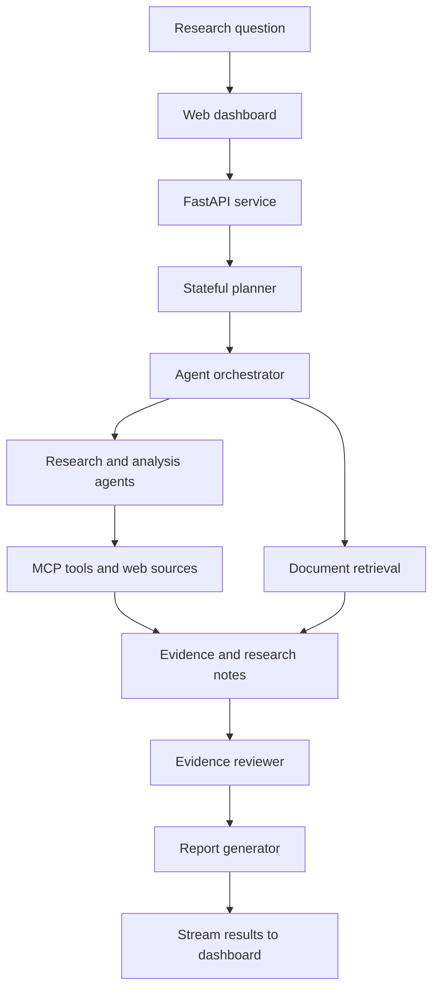

# Autonomous Deep Research Multi-Agent System

A Python platform that turns a research question into a structured, source-backed report. It combines web research, document retrieval, specialized agents, evidence verification, persistent research notes, and a live report dashboard.

The system plans multi-step investigations, gathers evidence through tools and MCP integrations, checks findings against their sources, and presents the results in a clear report.

## Capabilities

- Breaks a broad research question into focused, trackable tasks.
- Combines public web research with retrieval from a local document collection.
- Coordinates specialist agents and preserves useful context across the investigation.
- Verifies findings against collected evidence before generating the report.
- Streams run progress and presents the finished report in a browser dashboard.

## Architecture

The planner decomposes the request, the orchestrator assigns work, and the reviewer checks evidence before the report is returned.

