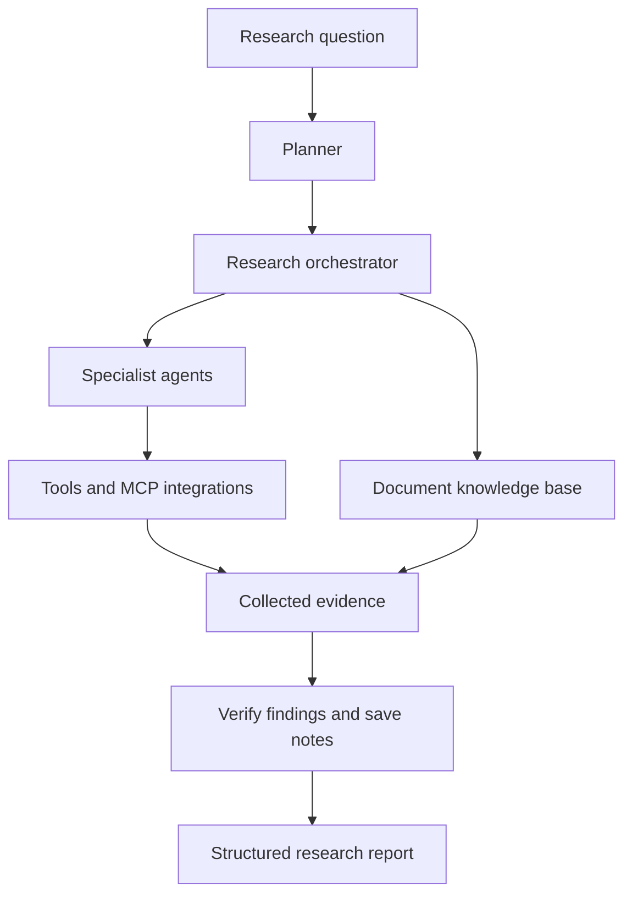

# Autonomous Deep Research Multi-Agent System

A Python research platform that turns a question into a structured, source-backed report. It brings together LLM assistants, conversation memory, reusable tools, document retrieval, agent planning, MCP, and multi-agent orchestration.

The project follows the practical path in [AI Agent Engineering: Build Production-Ready AI Agents](https://www.udemy.com/course/ai-agent-engineering/) by Pankaj Shukla and applies the course’s core techniques to a research workflow.


## What the platform does

The system takes a research question through a repeatable workflow:

- Breaks the question into focused research tasks.
- Uses specialized agents and tools to gather relevant information.
- Retrieves supporting passages from an ingested document collection.
- Keeps research state and notes available across steps.
- Checks findings against their sources and turns them into a structured report.

The same workflow supports both open-ended research and questions grounded in a supplied document set.


## Research workflow



The planner coordinates the work, while tools and document retrieval provide evidence for the final report.


## Course sections and skills

This map covers all 22 sections of the course. When a topic returns later, the row focuses on what that section adds.

| # | Course section | Skills covered |
| --- | --- | --- |
| 1 | Introduction | Project goals and the progression from a basic assistant to a research-agent platform |
| 2 | Day 1: Build Your First AI Chatbot using Python | Python fundamentals, API calls, Ollama setup, virtual environments, configuration, and a terminal assistant in VS Code |
| 3 | Day 2: Build an AI Assistant That Remembers: Conversation Memory | Role-tagged chat history, message persistence during a session, and inspecting assistant memory |
| 4 | Day 3: Prompt Engineering: Teach Your AI Assistant How to Behave | System prompts, assistant personas, role selection, and configurable multi-role behavior |
| 5 | Day 4: AI Tools: Teach Your AI Assistant to Use Tools | Custom Python tools, tool selection, reusable functions, request routing, and a centralized tool manager |
| 6 | Day 5: Document AI: Teach Your AI Assistant to Read Files | File-reader tools, passing document text to an LLM, document summarization, explanation, and question answering |
| 7 | Day 6: Build Your First RAG System | Multi-document knowledge bases, keyword retrieval, embeddings, semantic search, cosine similarity, and an end-to-end RAG pipeline |
| 8 | Day 7: Build Your First AI Agent | Agent planning, choosing tools, and connecting a planner to an assistant |
| 9 | Day 8: Model Context Protocol (MCP) | MCP architecture, client/server implementation, and connecting an agent planner to MCP tools |
| 10 | Day 9: Building an Autonomous AI Agent | Agent state, autonomous execution loops, MCP executor, and agent runner |
| 11 | Day 10: Advanced Agent Planning | LLM-based task decomposition, state-aware planning, task tracking, and answer generation |
| 12 | Day 11: Memory Engineering | Persistent memory with SQLite, long-term memory extraction, and semantic memory |
| 13 | Day 12: Advanced RAG | Metadata-aware chunks, overlap strategies, hybrid retrieval, re-ranking, FAISS and ChromaDB vector stores, and retrieval evaluation |
| 14 | Day 13: MCP in Depth | Multiple MCP servers, tool registries and arguments, resources and prompts, remote HTTP transport, authentication, and authorization |
| 15 | Day 14: Multi-Agent Systems & Orchestration | Manager/worker design, research/coding/review roles, agent communication, revision safeguards, sequential and parallel execution with asyncio |
| 16 | Day 15: Making Our AI Agent Production-Ready | Central configuration, structured logging, retries, backoff, timeouts, secrets, validation, permissions, safe file access, prompt-injection defenses, and context/performance tuning |
| 17 | Day 16: LangGraph | Graph state, planner/tool/answer nodes, conditional routing, human approval, checkpoints, and MCP tool integration |
| 18 | Day 17: CrewAI | Agents, tasks, crews, hierarchical managers, crew memory, and MCP tool integration |
| 19 | Day 18: Build Our AI Research Agent | Web search and webpage-reader tools, Ollama tool calling, research plans, structured notes, evidence verification, and reports |
| 20 | Day 19: LangChain for Agent Engineers | Prompt templates, LCEL, LangChain tools and agents, MCP integration, and RAG retrieval |
| 21 | Day 20: AI Agent Deployment | FastAPI, Pydantic validation, error handling, application lifecycle, health checks, Docker, Docker Compose, rate limiting, logging, and LLM-as-a-Judge evaluation |
| 22 | Day 21: Capstone Project: Build the Research AI Agent Platform | HTML/CSS/JavaScript interface, API integration, dashboard, live progress streaming, and report presentation |

## Runtime and dependencies

| Purpose | Tools used |
| --- | --- |
| Language and environment | Python 3.13, VS Code, virtual environments, and `python-dotenv` |
| Chat model access | OpenAI Python SDK with an OpenAI-compatible endpoint; Ollama for local chat and embeddings |
| Apple Silicon option | MLX-LM; the included helper serves `Qwen/Qwen3-1.7B-MLX-4bit` on port 8080 |
| Document extraction | `pypdf` for PDF files and optional `python-docx` for Word documents |
| Embedding model | `embeddinggemma-2:740m`, configurable through `EMBEDDING_MODEL` |

The course-specific frameworks, protocols, storage systems, deployment tools, and interface technologies are listed in the complete section map above.

## Repository structure

```text
.
├── Day01(Assistant)/              # First API-backed terminal assistant
├── Day02(Memory)/                  # Multi-turn conversation history
├── Day03(Prompt_engineering)/      # System prompts and selectable roles
├── Day04(Tools)/                   # Python tools, routing, and tool manager
├── Day05(Document_reading)/        # Text-file reading and document Q&A
├── embedding.py                    # Load, chunk, and embed supported documents
├── start_mlx_server.py             # Local MLX-LM server for Apple Silicon
├── requirements.txt
└── pyproject.toml
```

The day folders keep the examples easy to follow. The embedding utility handles `.pdf`, `.txt`, `.md`, `.py`, `.json`, `.csv`, and `.docx` files; DOCX extraction requires the optional `python-docx` package.

## Setup

Use Python 3.13 or later. Install the packages needed for the assistant and document utilities:

```bash
python3.13 -m venv .venv
source .venv/bin/activate
python -m pip install --upgrade pip
python -m pip install openai python-dotenv pypdf
```

For Word documents, install the optional parser:

```bash
python -m pip install python-docx
```

Create a `.env` file in the repository root and set the endpoint and model names available in your local runtime:

```dotenv
BASE_URL=http://localhost:11434/v1
API_KEY=ollama
MODEL=your-chat-model
EMBEDDING_MODEL=embeddinggemma-2:740m
```

Ollama is the default local endpoint for the embedding utility. On an Apple Silicon Mac, `python start_mlx_server.py` starts the included MLX-LM chat server on port 8080; set `BASE_URL=http://localhost:8080/v1` when using it for chat. Use the Ollama endpoint when generating embeddings, because the included MLX helper serves chat completions. Keep API keys in `.env`, not in source files.

## Run the examples

Run commands from the repository root unless noted:

```bash
python "Day01(Assistant)/assistant.py"
python "Day02(Memory)/memory.py"
python "Day03(Prompt_engineering)/system_prompts.py"
python "Day04(Tools)/assistant.py"
python embedding.py "path/to/document.pdf"
```

For the document-reading assistant, run it from its folder so its sample files resolve correctly:

```bash
cd "Day05(Document_reading)"
python assistant1.py
```

