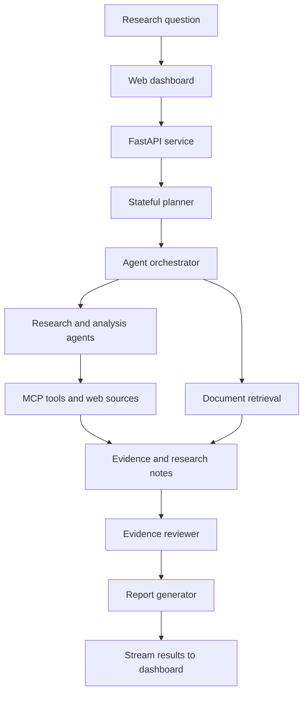

# Autonomous Deep Research Multi-Agent System

A Python platform that turns a research question into a structured, source-backed report. It combines web research, document retrieval, specialized agents, evidence verification, persistent research notes, and a live report dashboard.

The system plans multi-step investigations, gathers evidence through tools and MCP integrations, checks findings against their sources, and presents the results in a clear report.

## Capabilities

| Capability | What it does |
| --- | --- |
| Research planning | Breaks complex questions into trackable tasks with a state-aware planner and generates answers from completed work |
| Multi-agent execution | Coordinates Research, Analysis, and Review agents through manager/worker workflows, bounded review loops, and sequential or parallel execution |
| Web and tool access | Uses search and webpage-reading tools, custom Python functions, MCP servers, a shared tool registry, and remote HTTP integrations |
| Document-grounded answers | Extracts text from research documents, creates metadata-aware chunks and embeddings, combines keyword and semantic retrieval, reranks results, and uses FAISS or ChromaDB to find supporting passages |
| Persistent research memory | Stores conversation state and research notes in SQLite, extracts durable facts, and retrieves relevant semantic memories |
| Evidence and reporting | Checks claims against retrieved sources, retains evidence and notes, and produces structured research reports |
| Production interface | Serves the agent through FastAPI and Pydantic, with a browser dashboard, live progress updates, and report viewing |

## Architecture

The planner decomposes the request, the orchestrator assigns work, and the reviewer checks evidence before the report is returned.

