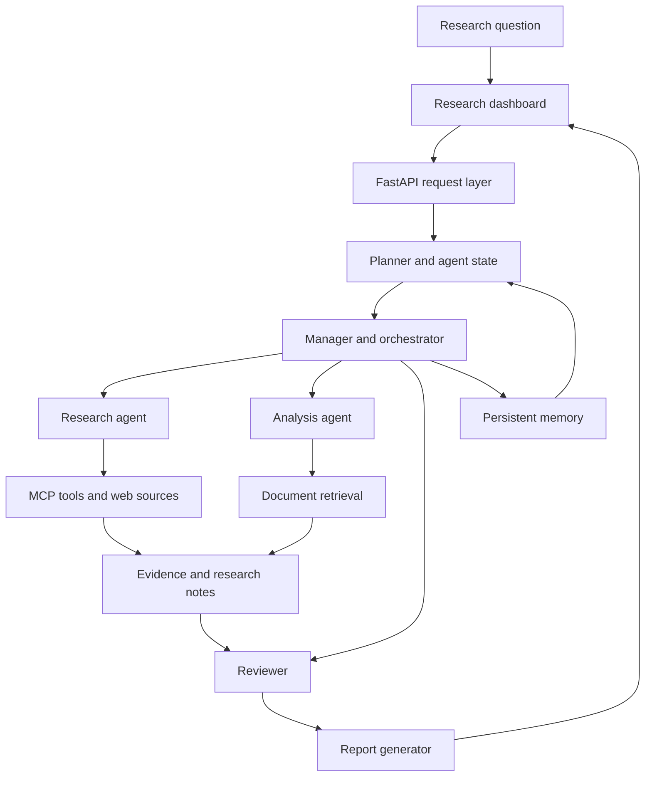
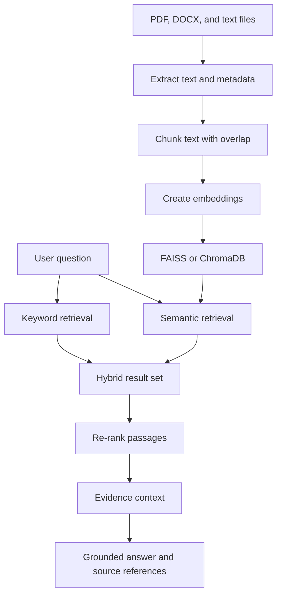

# Autonomous Deep Research Multi-Agent System

A research platform that turns a complex question into a structured, evidence-backed report. It combines web research, document retrieval, specialized agents, persistent memory, and a browser dashboard with live progress updates.

## Project overview

Research work often means switching between search, documents, notes, and review. This system brings those steps into one traceable workflow. It breaks a request into tasks, gathers evidence from public sources and local documents, coordinates agents to analyze and review the material, and produces a report with the supporting evidence.

Each run maintains its task state and research notes. The final response is built from retrieved evidence, while unsupported claims, conflicting sources, and open questions remain visible for review.

## Product capabilities

- **Research planning:** turns a broad question into smaller tasks and tracks each task through execution.
- **Web research:** searches for sources and reads relevant webpages through controlled tools.
- **Document question answering:** retrieves relevant passages from a collection of PDFs, Word files, and text documents.
- **Agent collaboration:** assigns research, analysis, and review work to specialized agents, sequentially or in parallel.
- **Persistent context:** keeps conversation history, extracted facts, and research notes available across steps.
- **Evidence review:** checks whether report claims are supported by retrieved sources and flags gaps.
- **Report delivery:** generates a structured report and streams progress to a browser dashboard.
- **Service deployment:** exposes the research workflow through a validated API and a container-ready application design.

## System architecture

The planner records the investigation state and delegates work. Research and retrieval return source material to a shared evidence trail; the reviewer checks it before the report reaches the dashboard.

## Research run lifecycle

| Stage | Work performed |
| --- | --- |
| 1. Scope | Validate the request and identify its research goal, constraints, and expected output |
| 2. Plan | Decompose the objective into tasks, dependencies, and an execution plan |
| 3. Research | Use web search, webpage reading, MCP tools, and local-document retrieval to collect relevant material |
| 4. Analyze | Combine retrieved evidence, update research notes, and identify agreement or conflict between sources |
| 5. Review | Check that findings are supported, surface missing evidence, and request bounded revisions where needed |
| 6. Synthesize | Produce an answer from the reviewed findings and retain relevant notes for later steps |
| 7. Deliver | Return the report and stream task progress and results to the dashboard |

## Document retrieval pipeline

The retrieval layer supports keyword matching and semantic similarity. Hybrid search combines both result types, and re-ranking selects the passages most useful for answering the question.

## Agent responsibilities

| Agent or component | Responsibility |
| --- | --- |
| Planner | Understands the request, decomposes it into tasks, and updates the task state |
| Manager / orchestrator | Assigns work, selects sequential or parallel execution, and keeps the investigation within defined limits |
| Research agent | Searches the web, reads pages, and records source-linked notes |
| Analysis or coding agent | Extracts information, compares evidence, and uses approved tools for focused subtasks |
| Reviewer / evidence verifier | Checks claims against evidence, identifies conflicts, and returns targeted revision requests |
| Report generator | Organizes reviewed findings into a clear summary with supporting sources and open questions |

## Memory and agent state

The system separates temporary working context from information that should remain available after a run:

- **Conversation state** stores role-tagged user and assistant messages for the active interaction.
- **Persistent memory** records useful facts and research notes in SQLite.
- **Memory extraction** identifies information worth retaining instead of saving every message as long-term memory.
- **Semantic memory** makes stored facts and notes retrievable by meaning when a later task needs them.
- **Agent state** tracks tasks, tool results, review feedback, and the current point in the execution loop.

This separation keeps the active prompt focused while allowing later tasks to reuse relevant context.

