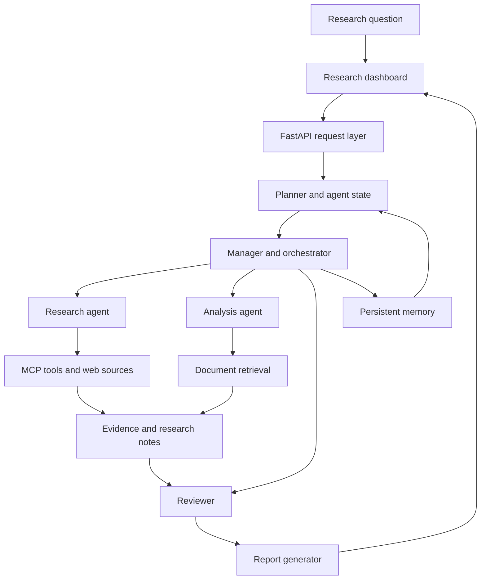
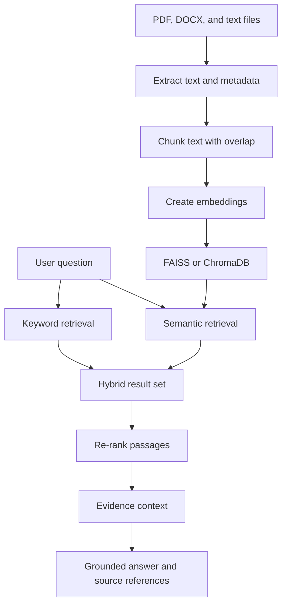

# Autonomous Deep Research Multi-Agent System

A research platform that turns a complex question into a structured, evidence-backed report. It combines web research, document retrieval, specialized agents, persistent memory, and a browser dashboard with live progress updates.

## Project overview

Research work often means switching between search, documents, notes, and review. This system brings those steps into one traceable workflow. It breaks a request into tasks, gathers evidence from public sources and local documents, coordinates agents to analyze and review the material, and produces a report with the supporting evidence.

Each run maintains its task state and research notes. The final response is built from retrieved evidence, while unsupported claims, conflicting sources, and open questions remain visible for review.

## Product capabilities

- **Research planning:** turns a broad question into smaller tasks and tracks each task through execution.
- **Web research:** searches for sources and reads relevant webpages through controlled tools.
- **Document understanding:** reads, summarizes, and explains files, then retrieves relevant passages to answer questions grounded in a collection of PDFs, Word files, and text documents.
- **Agent collaboration:** assigns research, analysis, and review work to specialized agents, sequentially or in parallel.
- **Persistent context:** keeps conversation history, extracted facts, and research notes available across steps.
- **Evidence review:** checks whether report claims are supported by retrieved sources and flags gaps.
- **Report delivery:** generates a structured report and streams progress to a browser dashboard.
- **Service deployment:** exposes the research workflow through a validated API and a container-ready application design.

## System architecture



The planner records the investigation state and delegates work. Research and retrieval return source material to a shared evidence trail; the reviewer checks it before the report reaches the dashboard.

## Research run lifecycle

| Stage | Work performed |
| --- | --- |
| 1. Scope | Validate the request and identify its research goal, constraints, and expected output |
| 2. Plan | Decompose the objective into tasks, dependencies, and an execution plan |
| 3. Research | Use web search, webpage reading, MCP tools, and local-document retrieval to collect relevant material |
| 4. Analyze | Combine retrieved evidence, update research notes, and identify agreement or conflict between sources |
| 5. Review | Check that findings are supported, surface missing evidence, and request bounded revisions where needed |
| 6. Synthesize | Produce an answer from the reviewed findings and retain relevant notes for later steps |
| 7. Deliver | Return the report and stream task progress and results to the dashboard |

## Document retrieval pipeline



The retrieval layer supports keyword matching and semantic similarity. Hybrid search combines both result types, and re-ranking selects the passages most useful for answering the question.

## Agent responsibilities

| Agent or component | Responsibility |
| --- | --- |
| Planner | Understands the request, decomposes it into tasks, and updates the task state |
| Manager / orchestrator | Assigns work, selects sequential or parallel execution, and keeps the investigation within defined limits |
| Research agent | Searches the web, reads pages, and records source-linked notes |
| Analysis or coding agent | Extracts information, compares evidence, and uses approved tools for focused subtasks |
| Reviewer / evidence verifier | Checks claims against evidence, identifies conflicts, and returns targeted revision requests |
| Report generator | Organizes reviewed findings into a clear summary with supporting sources and open questions |

## Memory and agent state

The system separates temporary working context from information that should remain available after a run:

- **Conversation state** stores role-tagged user and assistant messages for the active interaction.
- **Persistent memory** records useful facts and research notes in SQLite.
- **Memory extraction** identifies information worth retaining instead of saving every message as long-term memory.
- **Semantic memory** makes stored facts and notes retrievable by meaning when a later task needs them.
- **Agent state** tracks tasks, tool results, review feedback, and the current point in the execution loop.

This separation keeps the active prompt focused while allowing later tasks to reuse relevant context.

## Technical skills and tools

| Area | Skills, tools, and implementation details |
| --- | --- |
| Programming and development | Python 3.13, variables, user input, lists, functions, loops, JavaScript, `asyncio`, virtual environments, VS Code, project configuration, and environment variables |
| LLM integration | Ollama, OpenAI-compatible LLM APIs and Python client, local model serving with MLX-LM, prompt engineering, system prompts, assistant personas, and model tool calling |
| Tool engineering | Reusable Python functions, tool selection and routing, centralized tool management, argument handling, file-reader tools, current date/time, secure password generation, test and debugging workflows, and controlled tool execution |
| Document processing | Text, PDF, DOCX, Markdown, Python, JSON, and CSV inputs; `pypdf`; optional `python-docx`; text extraction, file metadata, and document normalization |
| RAG and retrieval | Multi-document knowledge bases, keyword retrieval, chunking and overlap, metadata, embeddings, semantic search, cosine similarity, hybrid search, re-ranking, grounded Q&A, and retrieval-quality evaluation |
| Vector databases | FAISS similarity search and ChromaDB collections and retrieval |
| Agent planning and execution | Agent state, task decomposition, state-aware planning, tool selection, execution loops, MCP execution, agent runners, and answer generation |
| MCP and integrations | MCP clients and servers, multiple-server connections, tool registries, tool arguments, MCP resources and prompts, remote HTTP transport, authentication, and authorization |
| Multi-agent orchestration | Manager-worker systems, research/coding/review roles, structured agent communication, iterative reviews, loop guards, sequential execution, parallel execution, and fan-out/fan-in |
| LangGraph | Graph state, planner/tool/answer nodes, conditional edges, routing, MCP tools, human approval, and checkpointing |
| CrewAI | Agents, tasks, crews, research/coding/review roles, hierarchical managers, crew memory, and MCP tools |
| LangChain | Prompt templates, LangChain Expression Language (LCEL), chains, tools, tool calling, agents, MCP integration, RAG retrieval, and agent state and memory |
| Research and reporting | Web search, webpage reading, research planning, structured notes, evidence verification, and structured report generation |
| Backend APIs | FastAPI, Pydantic request schemas, input validation, error handling, centralized model configuration, liveness/readiness checks, and application lifecycle management |
| Deployment and reliability | Docker, Docker Compose, retries, exponential backoff, timeouts, rate limiting, parallel execution, and context/model-call optimization |
| Security | Secrets management, permissions, safe file access, tool-boundary validation, remote-service authorization, and prompt-injection protection |
| Observability and evaluation | Structured logging, automated agent evaluation, retrieval and answer evaluation, and LLM-as-a-Judge |
| Frontend | HTML, CSS, JavaScript, API integration, research dashboards, real-time progress streaming, and report presentation |

## Framework patterns

The project keeps the agent behavior understandable while using frameworks where they add useful structure:

- **LangGraph** models the agent as a stateful graph. Planner, tool, and answer nodes are connected through conditional routes. Checkpoints preserve progress, and human approval can pause an action before execution.
- **CrewAI** groups specialized agents into tasks and crews. A hierarchical manager can delegate work, while crew memory and MCP tools provide shared context and external actions.
- **LangChain** provides reusable prompt templates and LCEL chains. Tools, tool-calling agents, RAG retrieval, MCP integrations, and framework-managed state connect into the research workflow.

The same workflow supports direct Python implementations where a framework would add unnecessary indirection.

## Reliability, security, and evaluation

Research results depend on both the model and the quality of its evidence. The application therefore applies controls at the boundaries:

- Validate API requests and tool arguments before execution.
- Treat web pages and uploaded documents as untrusted content; never let retrieved text override system instructions.
- Limit file access and external actions to explicitly permitted paths and tools.
- Use timeouts, retries with backoff, rate limits, and bounded review loops to prevent stalled or runaway runs.
- Keep secrets in environment variables and record run events through structured logs.
- Evaluate retrieval relevance and answer grounding, then use LLM-as-a-Judge scoring to review complete agent runs.

## Report format

A completed investigation is organized so a reader can move from the conclusion to the underlying evidence:

1. **Executive summary** — the central answer and its main implications.
2. **Research scope** — the question, assumptions, and boundaries used.
3. **Key findings** — concise claims grouped by topic.
4. **Supporting evidence** — source links or document references for each finding.
5. **Conflicts and gaps** — disagreements between sources and questions the available evidence does not settle.
6. **Research notes** — useful context retained for follow-up work.

The dashboard shows task progress while the report is being prepared and displays the finished result when the review step is complete.

## Local setup

Use Python 3.13 or later. Create a virtual environment and install the packages used by the local assistant and document utilities:

```bash
python3.13 -m venv .venv
source .venv/bin/activate
python -m pip install --upgrade pip
python -m pip install openai python-dotenv pypdf
```

For Word document extraction, install the optional parser:

```bash
python -m pip install python-docx
```

From the repository root, create `.env` from [the example](.envexample) if you do not already have a `.env` file:

```bash
cp .envexample .env
```

The example points to Ollama’s local OpenAI-compatible endpoint. Use `ollama list` to find the name of an installed chat model, then set `MODEL` in `.env` to that name. For the document embedding utility, install the example embedding model with `ollama pull embeddinggemma-2:740m`.

On an Apple Silicon Mac, `python start_mlx_server.py` starts the included MLX-LM chat server on port 8080. To use it for chat, set `BASE_URL=http://localhost:8080/v1` in `.env` and choose the chat model served by MLX-LM. Keep `BASE_URL` pointed at Ollama when running `embedding.py`. Keep real API keys in `.env`.

## Local utilities

Generate embeddings for a supported document:

```bash
python embedding.py "Day05(Document_reading)/Data/sample.pdf"
```

Start the included Apple Silicon chat server:

```bash
python start_mlx_server.py
```

The document utility supports `.pdf`, `.txt`, `.md`, `.py`, `.json`, `.csv`, and `.docx` inputs. DOCX extraction requires `python-docx`.

